<p align="center"></p>

#### Disclaimer: 
While guided and checked, AI is responsible for half of the coding. Development is also 100% for own personal use, no promises.
__________________________________

# Looking Glass

Self-hosted security monitoring for **OPNsense** (and your **Unraid** server). Looking Glass collects and stores the
firewall's logs and system state, detects attacks and anomalies, shows dashboards and reports, keeps a device
inventory of everything on your network, and includes an **AI analyst** that you can talk to (Claude or any other
OpenAI-compatible model) to find problems, vulnerabilities, hacking attempts, intruders and strange traffic.
The web UI is protected by a password **plus mandatory MFA** (authenticator app / TOTP or passkey).

Image: `ghcr.io/gittimeraider/looking-glass:latest` (linux/amd64 + linux/arm64), built by GitHub Actions.

## Screenshots

*Demo data: simulated OPNsense traffic and the mock OPNsense / UniFi / Unraid / AI servers from `tools/`.*

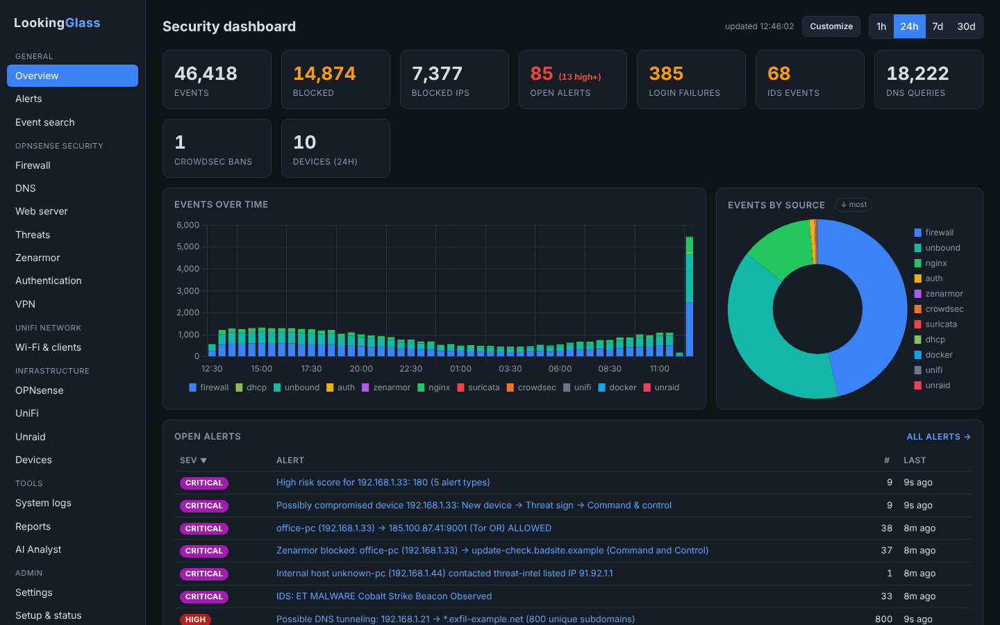

| | |
|---|---|
| **Alerts** - every alert says why it got its severity, which device it is and where it is connected; mute, re-rate or ask the AI | **AI analyst** - asks the database itself and answers with findings and actions |
| 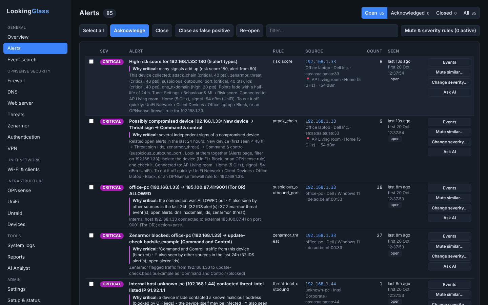 | 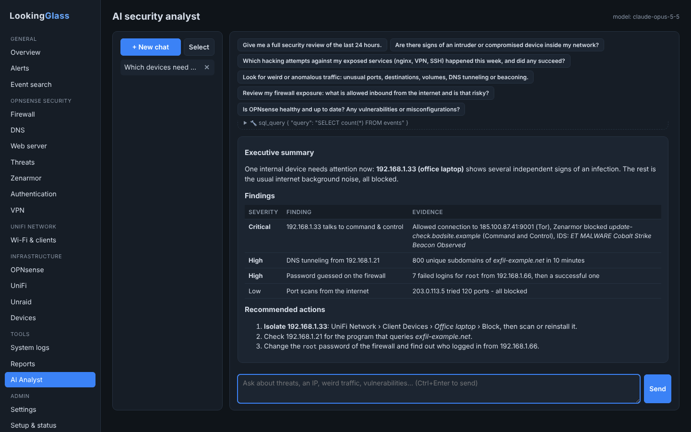 |
| **Firewall dashboard** - one of nine dashboards (DNS, web server, threats, Zenarmor, logins, VPN, Wi-Fi, logs) | **Devices** - inventory from ARP, DHCP, UniFi and Zenarmor, with risk score and learned behaviour |
| 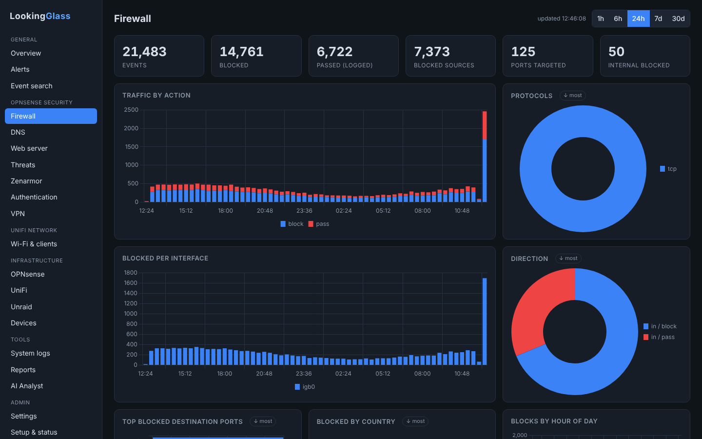 | 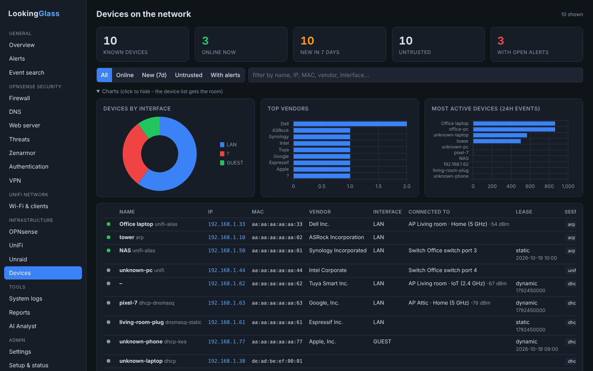 |
| **OPNsense** - hardware, load, temperatures, gateways, interfaces and services | **UniFi** - access points, switches, Wi-Fi and wired clients, neighbouring Wi-Fi |
| 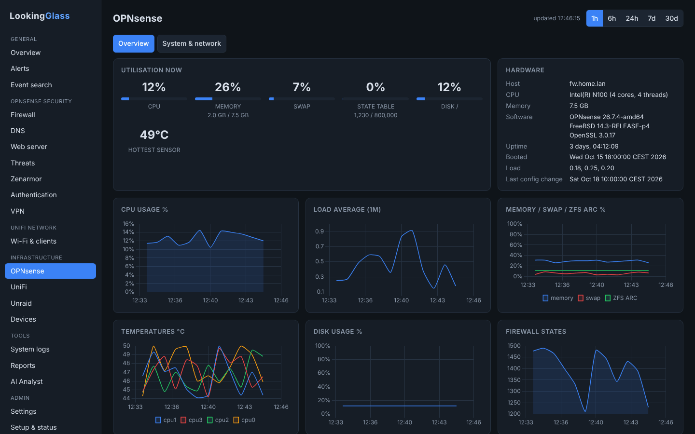 | 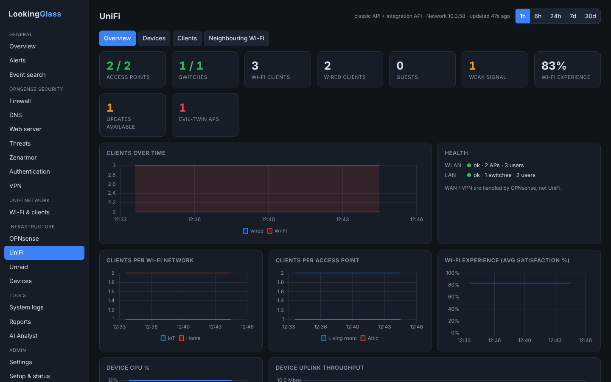 |
| **Unraid** - array, disks (never woken up), Docker, VMs, UPS | **Reports** - daily / weekly / monthly, with an AI analysis |
| 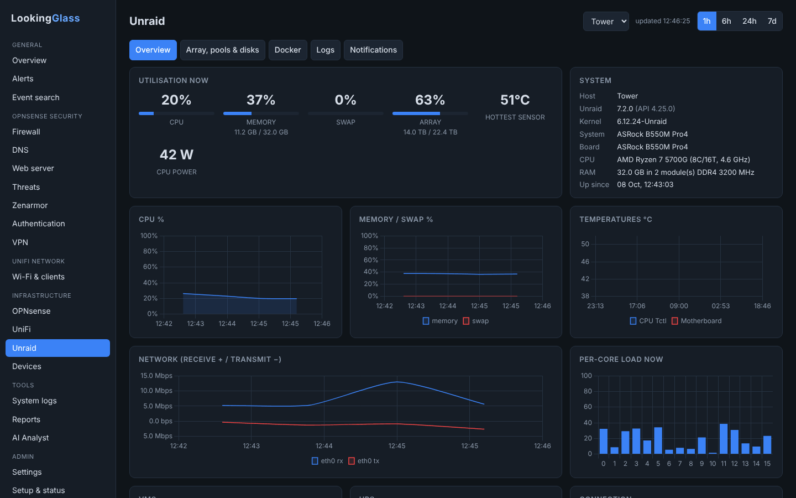 | 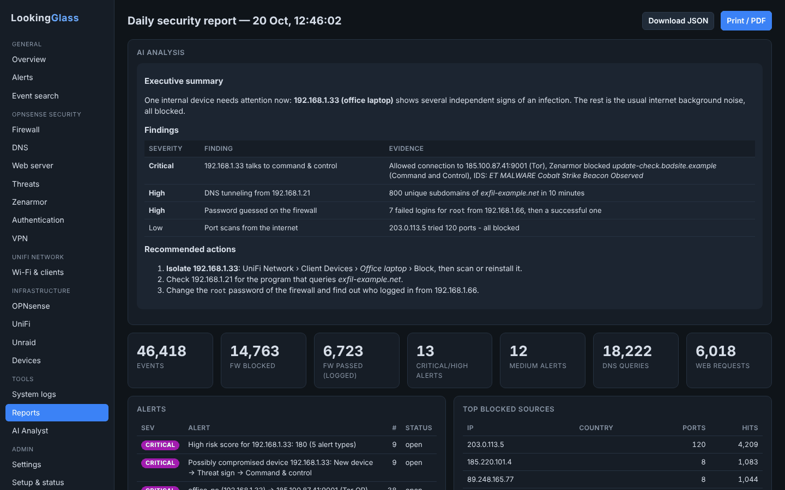 |
| **Setup & status** - checks every data source and says exactly what to change where | **Settings** - everything in the web UI (secrets encrypted), every detection with its own switches and exceptions |
| 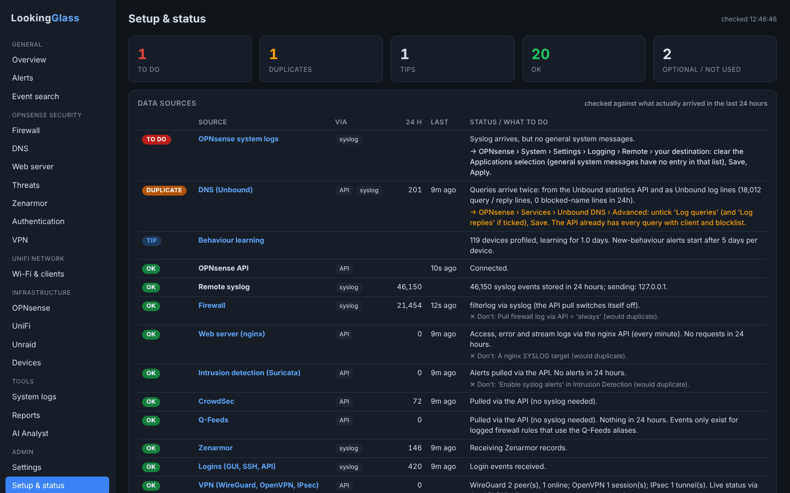 | 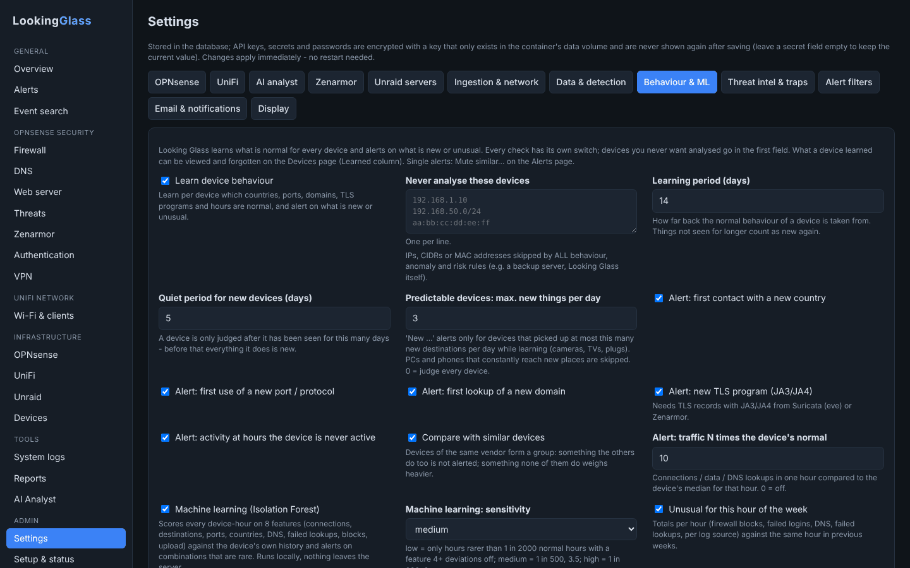 |

## What it collects

| Source | How | What you get |
|---|---|---|
| Firewall (pf `filterlog`) | syslog, or API fallback | blocked/allowed traffic, rule names, scans, sweeps |
| nginx plugin | syslog (access via nginx *SYSLOG Targets*, errors automatically) | requests, status codes, attack patterns (SQLi, RCE, traversal, scanners), WAF / rate limit |
| Unbound DNS | API (reporting DB) and/or syslog (`log-queries`) | per-client queries, blocklist hits, NXDOMAIN, DNS tunneling / DGA detection |
| CrowdSec | API (alerts + decisions) + syslog | scenarios, bans |
| Suricata IDS/IPS | API + syslog | signatures, classifications |
| Zenarmor | built-in Elasticsearch-compatible receiver (**works on the free edition**) or syslog (paid editions) | flows, DNS, TLS/SNI, HTTP, threat alerts, apps/categories, traffic volume, **device fingerprints** (name, vendor, OS) |
| Q-Feeds | API (events + stats) | threat-intel matches, especially **internal hosts contacting malicious IPs** (needs logged block rules, see step 5) |
| SSH / web GUI / OpenVPN / IPsec | syslog | failed and successful logins, config changes |
| DHCP leases (Kea, dnsmasq, ISC) + ARP | API + syslog | **device list**: name, IP, MAC, vendor, interface, lease, online state, per-device activity; **new/rogue device** alerts |
| System / hardware | API | CPU %, load, memory, swap, ZFS ARC, disks, temperatures, states, interface throughput/errors, gateways, services, top processes, firmware updates |
| **UniFi** | UniFi Network API (API key or local account) | access points, switches (ports, PoE, errors), consoles: state, firmware/updates, load; **Wi-Fi / wired clients** with AP or switch port, SSID, signal, experience, traffic; health; client connects / roams, device offline, **rogue / evil-twin APs, rogue DHCP**; and *where* every device is connected, shown in alerts and the device list |
| **Unraid** | Unraid API (GraphQL) + optional Docker socket proxy | CPU/cores, memory, temperatures, network, array/parity, disks (temp, errors, SMART), shares, **Docker containers** (state, CPU/mem) and **their logs**, Unraid syslog, **notifications**, VMs, UPS (Unraid UPS service, or the **NUT plugin** via upsd port 3493) |

## Built-in detections

Port scans, host sweeps, brute force (SSH / web GUI / VPN), **successful login after failures**, logins from public IPs,
web attacks & scanners, Suricata signatures, CrowdSec alerts, Q-Feeds hits (inbound probing / outbound C2), Zenarmor threats,
DNS tunneling, DGA domains, NXDOMAIN storms, malicious-domain lookups, internal hosts blocked to many destinations,
outbound connections on suspicious ports (Tor, IRC, RDP, SMB, mining pools…), new devices, UniFi access point / switch
offline, foreign APs using your Wi-Fi name ("evil twin"), rogue DHCP servers, gateway down, resources
(disk/memory/states) high, stopped services, firmware updates available and "logs stopped arriving" (possible tampering).

**Logins on all systems**: OPNsense (web GUI, SSH, API, VPN), **Unraid** (web GUI and SSH, from its syslog) and the
**UniFi controller** (admin logins with their address) all feed the same login rules: brute force, password spraying,
login after failures, logins from the internet and logins from a new country. Alert titles say which system was hit
("Brute force against Tower (webGUI)"). The UniFi Network application does not report *failed* admin logins.

**Correlation rules** (inspired by RITA / Zeek beacon analysis, Sigma rules and MITRE ATT&CK):

| Rule | What it finds |
|---|---|
| Password spraying | one address trying 5+ usernames in an hour (T1110.003) |
| Distributed brute force | one username attacked from 10+ addresses (botnet); critical if one of them then logs in |
| Login from a new country / impossible travel | a user logging in from a country never seen in 90 days, or two countries within 2 h (needs GeoIP) |
| Beaconing | a device contacting a domain / address nobody else uses at a near-constant rhythm for hours - malware check-ins (T1071) |
| Lateral movement | one device reaching SSH / SMB / RDP / WinRM / VNC / Docker API on 5+ internal hosts in 15 min (T1021) |
| DNS bypass | devices using DNS servers on the internet directly, past your resolver and blocklists |
| Unusual upload | 1 GB+ sent to the internet in an hour and 5× more than the device's 7-day average (Zenarmor; T1048) |
| Attack chain | ties alerts about one address together: outside *recon → attack → access*, or inside *threat sign → command & control → spreading* (plus "new device"); high or critical |

*NAT redirects*: a port forward that sends DNS / NTP (or any port) to your own server, e.g. *VLAN_IoT TCP/UDP to !RFC1918 port domain ⇒ VLAN_IoT address*, answers those packets locally, but Zenarmor (it sees packets before NAT) and the firewall's pass log still show the original destination. DNS bypass, Tor and threat-feed alerts therefore skip traffic on redirected ports that the firewall never logged leaving towards the internet - e.g. an NTP query to a pool server that is also a Tor relay. Looking Glass knows the redirects from the API (privilege *Firewall: NAT: Port Forward*) or from the NAT rule's own log lines (tick *Log* on it).

*DGA domains* are random-looking names such as `kq3v9x7w2m8p4z1r.com`, which malware generates by the thousands
(Domain Generation Algorithm) to find its control server. Some CDNs and latency probes use random names too: list
those under *Settings › Data & detection › DNS: domains to ignore* (subdomains included) and the DNS checks skip them.

### Muting alerts (alert filters)

*Settings › Alert filters* (or **Mute similar…** on any alert, which pre-fills one) stops alerts you don't want:

* Conditions: **severity** (e.g. "low and below"), **rules / sources** (tick one or more), **text** in the title or
  description (several terms: comma separated, *any* or *all* of them), **IP addresses / networks** (source or
  destination) and **source / destination ports** (ports and ranges, `22, 8000-8100`). A port condition matches only
  when *every* port of the alert's events on that side is in the list - muting port 22 never hides an alert that also
  hit 3389 - and never for an alert without known ports. **Mute similar…** pre-fills the destination port when the
  alert has exactly one. Ranges copied from documentation with an en dash (`19294–19344`) are accepted too. Example,
  Discord voice calls flagged as beaconing: rule *Beaconing* + IP *192.168.3.3* + destination ports *19294-19344*, all
  conditions must match (the ports of an address-beaconing alert are those of the traffic to that address only).
* **AND / OR**: per filter choose *all conditions must match* or *any one is enough*. Inside one condition it is always
  "or" (any ticked rule, any listed IP), and filters together work as "or" - so "(A and B) or C" is two filters.
* Action: **don't create** the alert, **create it as closed** (kept under Alerts › Closed for reference), or
  **change the severity** to the level you choose - e.g. "new device on 192.168.30.0/24 → high" or "port scans → info".
  Severity changes are applied first, mute filters then see the new severity. Logs, dashboards and reports are never
  affected.
* **Change severity…** on any alert pre-fills such a rule; re-rated alerts show "⚙ Severity changed by … (was low)"
  with **Undo** (deleting the rule gives open alerts their own severity back).
* **Preview** shows what a filter would have caught in the last 30 days; **close matching** closes existing ones.
* **Unmute**: alerts matched by a filter show "🔇 Muted by …" with an **Unmute** button on the Alerts page; in the
  filter list, untick *On* to pause a filter or use *unmute (delete)*. Each filter counts its hits.
* **Undo / adjust anything**: every muted or re-rated alert links (✎) to the rule that did it, so you can edit, pause or
  delete it; a re-rated alert also has **Restore <old severity>** for just that alert. The Alerts page shows
  **Mute & severity rules (N active)**, a direct link to the full list.
* **Configuration changes** name what was changed and by whom, e.g. *Configuration change on fw: Nginx by admin from
  192.168.1.10* (taken from the OPNsense audit log line). Filter on the part with the text condition (`Nginx`,
  `Unbound DNS`, `firewall rules` …), on the user (`admin`) or on the IP condition (the address the change came from).
  **Mute similar…** on such an alert pre-fills the rule and the changed part.

### Email notifications

*Settings › Email & notifications*:

1. **Mail server (SMTP)**: server, port, encryption (`starttls` on 587, `ssl` on 465, `none` only for a relay inside
   your network), username / password (stored encrypted; Gmail and Microsoft 365 with MFA need an **app password**),
   sender address and the address you open Looking Glass on (for the links in the mails). **Send test mail** checks it
   before you save.
2. **Notification rules** ("mail me when…"): the same conditions as alert filters plus a **minimum severity**
   (e.g. *high and above*), one or more recipients, **how often** (right away, or at most every 5 min … daily digest:
   alerts in between are bundled into one mail) and *also mail when the severity of an alert goes up*. Each alert is
   mailed once per rule; muted alerts are never mailed. **Preview** shows what a rule would have matched, **send test**
   mails the newest matching alert, untick *On* to pause a rule. Delivery errors show in the rule list.

### Closing an alert

**Close** sticks: while the same thing keeps happening, the closed alert only counts the new sightings - it comes back
as open only when it gets **worse** (higher severity) or after 24 quiet hours. **Close as false positive** does the same
and also teaches Looking Glass (repeated ones become a mute / lower suggestion). To never see something again: **Mute
similar…**. **Trusted** on the Devices page marks a device as known: it is never counted as "new device" in attack
chains (it does not silence real alerts about the device).

### Behaviour & machine learning

*Settings › Behaviour & ML* - every check has its own switch, and **Never analyse these devices** (IPs, CIDRs, MACs)
excludes devices from all of them.

| Check | What it does | Tune it with |
|---|---|---|
| **Device profiles** | learns per device (MAC) which countries, ports, domains, TLS programs (JA3/JA4) and hours are normal; alerts on the first use of something new | learning period, quiet period for new devices, one switch per kind |
| **Predictable devices only** | "new …" alerts only for devices that rarely pick up anything new (cameras, TVs, plugs) - PCs and phones are skipped automatically | *max. new things per day* (0 = all devices) |
| **Similar devices** | devices of the same vendor form a group: what the others do too is normal, what none of them do weighs heavier | on / off |
| **Odd hours** | activity at an hour the device has never been active | on / off |
| **Traffic spike** | connections, DNS lookups or upload of one hour N× the device's median | factor (0 = off) |
| **Machine learning** | an Isolation Forest (one per pair of 8 features, pure Python, nothing leaves the server) scores each device-hour against the device's own history; alerts name the features that were off ("connections 9,000, normally ~100") | sensitivity low / medium / high |
| **Hour of the week** | network totals (blocks, failed logins, DNS, NXDOMAIN, per log source) against the same hour in previous weeks | sensitivity, metrics to ignore |
| **Risk score** | every alert adds points (info 1 … critical 40, once per rule) that fade with a half-life; one alert when a device's total is high; shown on the Devices page | threshold, half-life, addresses to skip |
| **Learning from false positives** | **Close as false positive** on the Alerts page; the same rule + address 3× in 30 days becomes a suggestion (mute / lower to info), or in *auto* mode a "Learned: …" severity rule (visible and removable under Alert filters) | suggest / auto / off, how many |

**Devices › Learned** shows what was learned for a device and lets you forget it (per kind or everything). The
**Delete collected data** option in Settings can also clear all learned behaviour.

### Threat intel & traps

*Settings › Threat intel & traps*:

| Check | What it does | Set up / tune |
|---|---|---|
| **abuse.ch feeds** | URLhaus (malware sites), ThreatFox (malware / C2 domains and IPs), Feodo Tracker (botnet C2), SSLBL (malware JA3) - daily, matched against DNS lookups, connections and TLS fingerprints. A malware URL on a shared site (GitHub, Steam, Discord, Google Drive, ...) does not flag the whole site; ThreatFox IOCs below 50% confidence are skipped. A list moved? *Feed download addresses*: one `feed: URL` per line (or `feed: POST URL {json}`), tried before the built-in ones | a free **abuse.ch Auth-Key**: [auth.abuse.ch](https://auth.abuse.ch) › log in › Optional › Generate Auth-Key, paste it, Save, **Update feeds now**; one switch per feed; *Never flag these domains / IPs* |
| **Tor** | devices connecting to Tor relays; optionally Tor exits reaching your services | outbound / both / off; *Devices allowed to use Tor* |
| **Crypto mining** | lookups of / connections to mining pools (built-in list) | extra pool domains, on / off |
| **Newly seen domains** | remembers the first lookup of every domain; beaconing to a brand-new domain weighs heavier; optionally asks the registry (RDAP) for the registration date and alerts on domains younger than N days | on / off, RDAP on / off (sends those domain names to the registry), age, lookups per hour |
| **Canary addresses** | IPs / ports nothing should ever use - any contact is someone exploring the network | see below; sources to ignore; inside only / also internet |
| **Exposure watch** | alerts when a port forward or firewall rule is added / changed (medium when it opens something to the internet) | on / off; OPNsense 25.7+ shows details (API privileges *Firewall: Rules* and *Firewall: NAT*), older versions compare rule names |
| **ARP spoofing** | a device claiming the firewall's address, an IP flipping between devices, one device holding many IPs | IPs / MACs to ignore (CARP, repeaters, VM hosts), flips per hour |
| **Malware TLS** | JA3 fingerprints of known malware (SSLBL) | needs TLS records: OPNsense › Services › Intrusion Detection › Administration › *Enable eve syslog output* with TLS logging |

**Canary setup** (traffic inside one subnet never passes the firewall, so use the firewall itself or another VLAN):
1. OPNsense › Firewall › Rules › LAN › **+**: Action *Block*, Protocol *TCP*, Destination *This Firewall* (or *LAN address*),
   Destination port e.g. *23* (telnet) - repeat for *445* and *3389* - tick **Log packets that are handled by this rule**,
   place it **above** the allow rules, Save, Apply.
2. Looking Glass › Settings › Threat intel & traps › **Canary addresses**: `192.168.1.1:23, 192.168.1.1:445,
   192.168.1.1:3389` (your firewall's LAN address), Save.

### AI analysis: timeouts and "504 Gateway Timeout"

A report's AI analysis is an agent run of several model calls (the model looks into the data with its tools) and runs
in the background: the report opens right away, the AI part fills in when ready, and a failure shows the reason with
**Retry AI analysis**. Answers are **streamed** (*Settings › AI analyst › Stream answers*, on by default): gateways and
proxies in front of a model (OpenRouter, LiteLLM, Cloudflare, nginx) often cut off requests that send nothing for 60-100
seconds, which is what a 504 means - a streamed answer keeps the connection busy. Overload / gateway errors (429, 502,
503, 504) are retried twice. Still 504? Raise the timeout of your own proxy (e.g. LiteLLM `timeout`, nginx
`proxy_read_timeout`), use a faster model or lower *Max tool rounds*.

The **AI chat** works the same way: the question starts the run on the server and the page asks for the result
every few seconds, so a reverse proxy in front of Looking Glass itself (nginx `proxy_read_timeout`, 60 s by default)
no longer cuts long answers off.

### How severity is decided

Every alert shows **"Why <severity>"**: the base reason and every step up (↑) or down (↓). The same four questions
decide it for every rule:

1. **Did anything get through?** Blocked traffic from the internet is background noise that every public IP gets.
   Allowed connections, successful logins and attacks that got a 2xx/3xx answer are what matter.
2. **Where does it come from?** The same behaviour from *inside* your network (a scan, password guessing, contact with a
   malicious address) is worse than from the internet: it means a device of yours misbehaves.
3. **Do other sources confirm it?** When the same IP also has IDS alerts, threat-intel (Q-Feeds) hits, Zenarmor threat
   events or other open alerts in the last 24 hours, the alert goes up one or two steps. Alerts built from the same
   events (e.g. a brute force and the login after it) don't count as confirmation for each other. Traffic that was
   **blocked** - by the firewall, Zenarmor, Q-Feeds, Suricata in IPS mode or a DNS blocklist, in any rule (scans,
   threat feeds, Tor, suspicious ports, beaconing, lateral movement, ...) - stays at **high** at most, however much
   confirms it, and so does an attack chain whose steps were all blocked: critical is for what got through. Only your
   own *Change the severity* rules can still set critical.
4. **How reliable is the signal?** Size is not severity: a scan of 400 ports is still a scan.

| Situation | Severity |
|---|---|
| Port scan / host sweep from the internet (any size) | **no alert** - blocked scans are background noise every public IP gets, also when one reaches an open port you host; **high** if the scanner logged in, **medium** if it also got successful answers from an attack on your web server |
| Port scan / host sweep from inside | medium, up to high / critical when other sources confirm |
| Password guessing from the internet / from inside | medium / high |
| Login succeeded after failures: from the internet / from inside (5+ failures) / from inside (few failures, typos) | critical / high / medium |
| Admin (GUI / SSH / API) login from the internet / VPN login from the internet / any login from inside | high / low / info |
| Web attack: RCE / SQLi, path traversal / sensitive file, scanner signatures | medium, low, info - one step up if a request got a successful response or comes from inside |
| Web scanning (many 4xx) from the internet / from inside | low / medium |
| IDS | Suricata's priority (1 = critical … 4 = low), one step down when IPS mode dropped it, up when confirmed |
| CrowdSec decision for an internet IP / for an internal IP | low (it is handled) / high |
| Internal device contacted a threat-intel address (blocked by Q-Feeds) / internet address of a threat list probes you | low - medium / high when other sources confirm it or the device keeps coming back (blocked threat traffic in 6+ separate 10-minute periods, or to 5+ different sites, in 24h - retries and subdomains of one page visit count once) / info |
| Zenarmor malware / C2 / phishing: blocked / NOT blocked; other categories: blocked / not blocked | low (up to high like Q-Feeds above) / critical; low / medium (blocked ones per *Settings › Zenarmor › Alert on traffic Zenarmor blocked*: threats only by default, all or never) |
| DNS tunneling, DGA names, NXDOMAIN storm | high, medium, low - each up when confirmed |
| Malicious domain looked up (blocked): 1-2 domains / 3+ | medium / high, up when confirmed |
| Suspicious outbound port (Tor, IRC, RDP, SMB, mining…) blocked / allowed | low / medium, up when confirmed |
| Gateway down / degraded, security service stopped / other service stopped, logs stopped | high / low, medium / low, medium |
| UniFi: switch offline / AP offline, foreign AP with your Wi-Fi name (open or strong signal: up), rogue DHCP | high / medium, medium-high, high |
| New device | low |

Severities of rules that look at a time window (scans, brute force, DNS) are re-evaluated on every run, so they can
go down again when the confirming evidence is older than 24 hours; rules that react to new events only ever go up.

---

## Installation

You need a machine that runs Docker (Linux server, NAS, VM…) and that the OPNsense box can reach.
Looking Glass uses its own PostgreSQL container (included in the compose file) — no separate SQL server needed.
If you prefer an existing PostgreSQL 14+ server, use `examples/docker-compose.external-postgres.yml`.
No passwords or API keys go into environment variables: the database connection and your login are entered in a
setup wizard on first start, the integrations later under *Settings* — all stored encrypted.

### 1. Create the API key in OPNsense (OPNsense web UI)

1. Open **System › Access › Users**, click **+** and create a user, e.g. `lookingglass` (any random password).
2. Give it privileges. Simplest: tick **GUI - All pages**. Stricter: only the *Diagnostics*, *Reporting*, *Firmware*,
   *Gateways*, *Unbound*, *CrowdSec*, *Q-Feeds* and *Intrusion Detection* pages (Looking Glass's *Setup & Status* page
   shows every API call that is refused, so you can add the missing privilege later).
3. Save, open the user again, scroll to **API keys** and click **+**. Your browser downloads a text file with
   `key=...` and `secret=...`. Keep it for step 3.

### 2. Get the files (shell on your Docker host)

```bash
mkdir -p ~/looking-glass && cd ~/looking-glass
curl -O https://raw.githubusercontent.com/GitTimeraider/Looking-Glass/master/docker-compose.yml
mkdir -p data secrets && sudo chown 10001:10001 data    # the container runs as this uid:gid, never as root
# password for the bundled PostgreSQL, read from a file instead of an environment variable:
openssl rand -hex 24 > secrets/db_password && chmod 700 secrets && chmod 644 secrets/db_password
```

(`chmod 644` on the file is needed because the non-root containers must be able to read it; the `secrets` folder
itself stays closed to other users on the host.)

Other ready-made compose files are in [`examples/`](examples):

| File | Use it when |
|---|---|
| [`docker-compose.yml`](docker-compose.yml) | standard: Looking Glass + its own PostgreSQL |
| [`examples/docker-compose.https.yml`](examples/docker-compose.https.yml) + [`Caddyfile`](examples/Caddyfile) | you want HTTPS (required for **passkeys**) via a bundled Caddy reverse proxy |
| [`examples/docker-compose.external-postgres.yml`](examples/docker-compose.external-postgres.yml) | you already run PostgreSQL 14+ |
| [`examples/docker-compose.all-in-one.yml`](examples/docker-compose.all-in-one.yml) | Portainer / Dockge stacks: no files next to the stack |
| [`examples/docker-compose.secrets.yml`](examples/docker-compose.secrets.yml) | unattended install without the wizard (database + first login from Docker secret files) |
| [`examples/docker-compose.build.yml`](examples/docker-compose.build.yml) | build the image from source |
| [`examples/docker-compose.unraid-socket-proxy.yml`](examples/docker-compose.unraid-socket-proxy.yml) | run **on Unraid** for per-container CPU/memory on Unraid API older than 4.29 |
| [`examples/unraid/looking-glass.xml`](examples/unraid/looking-glass.xml) | run Looking Glass itself **on Unraid** as a Docker template |

### 3. Optional: `.env` (shell on your Docker host, in `~/looking-glass`)

Not needed for a standard install. Download it only to change one of these
(`curl -o .env https://raw.githubusercontent.com/GitTimeraider/Looking-Glass/master/.env.example`, then `nano .env`):

* `PUID` / `PGID` – the user and group the container runs as (the compose file passes them to `user:`; default
  10001). The `data` folder must belong to them: `sudo chown -R <PUID>:<PGID> data`. See
  [Running hardened](#running-hardened-non-root-no-capabilities).
* `PUBLIC_URL` – only when you use HTTPS / a reverse proxy, e.g. `https://looking-glass.home.lan` (for passkeys).

### 4. Start, run the setup wizard and log in

On the Docker host, in `~/looking-glass`:

```bash
docker compose up -d
docker compose logs looking-glass        # shows the one-time setup code
cat secrets/db_password                  # the database password, for the wizard
```

The log contains a block like:

```
FIRST-TIME SETUP: open the web UI (port 8080) and enter this setup code:
    K7QM-2XHD-9WPA
```

In your browser open `http://<docker-host>:8080`. The setup wizard asks for:

1. **Setup code** – from the log above. It makes sure only someone with access to the Docker host can set up a
   fresh instance. After 10 wrong attempts a new code is printed.
2. **Database** – for the bundled database keep the defaults (host `db`, port `5432`, database and user
   `lookingglass`) and paste the password from `secrets/db_password`. *Test connection* tells you exactly what is
   wrong (wrong password, unknown host, missing database, missing rights). *Save & continue* creates the tables.
   The connection is stored encrypted in `data/database.conf`. Pointing it at a database that already holds Looking
   Glass data reuses it.
3. **Account** – your user name and password (at least 10 characters).

You land on the login page. After logging in you are sent to **Account & MFA** and must set up a second factor
before anything else is accessible:

* **Authenticator app (TOTP)** – click *Set up authenticator app*, scan the QR code with Google/Microsoft
  Authenticator, Aegis, 1Password, Bitwarden…, type the 6-digit code, *Confirm*.
* **Passkey / security key** – type a name, click *Add passkey* and follow your browser / phone / YubiKey prompt.
  Passkeys only work when Looking Glass is opened over **HTTPS** (or `http://localhost`); use
  `examples/docker-compose.https.yml` or your own reverse proxy (Nginx Proxy Manager, Traefik, SWAG…).

Next logins ask for password + TOTP code or passkey.

> **Changing the database later** (other server, new password): shell on the Docker host,
> `docker exec looking-glass python -m lookingglass.cli setup-database`, then `docker restart looking-glass` and
> open the web UI – the wizard asks for the connection again (new setup code in the log). Your data and accounts
> stay in the database.

### 5. Enter your integrations (Looking Glass web UI › **Settings**)

* **OPNsense** tab – URL (e.g. `https://192.168.1.1`), the API key and secret from step 1 → *Test connection* → *Save*.
* **AI analyst** tab – your Anthropic API key (<https://console.anthropic.com> › *API keys*). Base URL
  `https://api.anthropic.com/v1/` and model `claude-opus-5-5` are pre-filled; any other OpenAI-compatible service
  (OpenAI, OpenRouter, LiteLLM, Ollama at `http://host:11434/v1/` …) works by changing base URL, model and key.
  *Test connection* → *Save*.
* **Ingestion & network** tab – set *Syslog allowed senders* to your OPNsense IP and your *Time zone*.
* **Display** tab – *Time format*: 24-hour (default, 14:05), 12-hour (2:05 PM) or your browser's default - for the
  web UI, notification mails and the AI analyst (mails and AI write times in your *Time zone*).
  *Theme*: dark (default), light, or auto (follows the browser / operating system), and an *Accent color* (blue,
  indigo, purple, pink, red, orange, green, teal, cyan or gray) for buttons, links and a light tint of the background -
  e.g. light + purple, dark + purple. The page previews your pick right away; *Save* keeps it.
* **Zenarmor** / **Unraid servers** / **Data & detection** tabs – optional (see the sections below).

Everything applies immediately. API keys, secrets and passwords are encrypted (Fernet/AES) with a key that is
generated on first start in the data volume (`/data/lookingglass.key`, readable only by the app user). They are
never shown again in the UI or API - a field only says *set* / *not set*. **Back up `./data/lookingglass.key`
together with your database**; without it the stored credentials can't be decrypted (you would just re-enter them).

> Upgrading from a version that used `OPNSENSE_*`, `AI_*`, `UNRAID_*` … environment variables? They are imported
> into the encrypted store automatically on the first start (the log tells you which) – then delete them from your
> compose/.env file.

> Upgrading from a version with `DATABASE_URL` / `POSTGRES_PASSWORD` / `ADMIN_*` in `.env`? It keeps working
> unchanged (`DATABASE_URL` from the environment takes precedence over the wizard). To get rid of them: download the
> new `docker-compose.yml`, write your current `POSTGRES_PASSWORD` into `secrets/db_password` (commands in step 2,
> e.g. `grep ^POSTGRES_PASSWORD= .env | cut -d= -f2- > secrets/db_password`), delete `POSTGRES_PASSWORD`,
> `DATABASE_URL`, `ADMIN_USER` and `ADMIN_PASSWORD` from `.env`, run `docker compose up -d` and complete the wizard
> (database step only - your accounts and data are kept). PostgreSQL only reads its password when it creates the
> database, so the existing database keeps its password.

> Port 514 on the host must be free. If something else uses it, change `"514:5514/udp"` in `docker-compose.yml`
> to e.g. `"1514:5514/udp"` and use that port in OPNsense in the next step.

### Forgot the password or lost the MFA device?

1. On the login page click **Forgot password / lost MFA device?** (or open `http://<docker-host>:8080/reset`) and
   click **Generate reset code**.
2. Read the code from the container log – shell on the Docker host: `docker logs looking-glass --tail 20`
   (Unraid: Docker tab › Looking Glass icon › *Logs*; Portainer: *Containers › looking-glass › Logs*). It looks like
   `Reset code: 7F3A-91BC (valid 15 minutes, single use)`.
   Alternatively create a code from the shell: `docker exec looking-glass python -m lookingglass.cli reset-code`.
3. Enter the code and a new password on the reset page. Password **and** all MFA factors are reset; you set up
   MFA again at the next login. Codes are single use, expire after 15 minutes and are destroyed after 5 wrong attempts.

### 6. Send logs from OPNsense (OPNsense web UI)

These steps were checked against the current OPNsense documentation and source (26.x).

1. **Remote syslog** – **System › Settings › Logging**, tab **Remote** (on older versions *System › Settings › Logging / targets*), click **+** (add a *Destination*):
   * Enabled ✓, Transport `UDP(4)` (or `TCP(4)`)
   * Applications: leave **empty** (= everything, recommended). Only then are the general system logs (kernel,
     opnsense …), sshd logins and API-key failures sent, because none of them has an entry in the list.
   * Levels: select everything from *info* up
   * Hostname: IP of your Docker host, Port: `514`
   * **rfc5424** ✓
   * Save, then **Apply**.
2. **Firewall logging** – default block rules are logged already. Open your important pass rules / port forwards
   (**Firewall › Rules › WAN** etc.) and tick **Log packets that are handled by this rule** so allowed traffic is visible too.
3. **Unbound DNS** – **Reporting › Settings**: enable the Unbound DNS statistics (off by default; Looking Glass then pulls
   every query with client, answer and blocklist via the API). Don't also enable *Log Queries* / *Log Replies* in
   **Services › Unbound DNS › Advanced** – that duplicates every query and slows Unbound down.

> **Check your setup:** Looking Glass › **Setup & status** lists every data source with what actually arrived in the last
> 24 hours and through which channel, marked *to do* (what to change, and where), *duplicate* (the same data arrives
> twice – which one to switch off), *tip*, *ok* or *optional*. Each source needs only one channel.
4. **nginx plugin** – nothing to do. OPNsense remote syslog never forwards nginx *access* logs; they exist only as files.
   Looking Glass therefore reads access, error and stream logs through the nginx log API every minute (*Settings ›
   OPNsense › Pull nginx access / error logs*; the API user needs the nginx pages). For real-time delivery instead:
   **Services › Nginx › Configuration**, tab **Other › SYSLOG Targets**, add a target (Host = Docker host,
   Port = 514, Severity *info*), then select it in each **HTTP(S) › HTTP Server** under *SYSLOG targets*.
   nginx then sends straight to Looking Glass over UDP.
   **VPN** – WireGuard writes no connection logs, so WireGuard peers (status, last handshake, traffic), OpenVPN sessions
   and IPsec tunnels are read from the API (*Pull VPN status*). A WireGuard peer going online or offline becomes an event.
5. **Suricata** – nothing to do: alerts are pulled from the API. Don't also tick *Enable syslog alerts* in
   Intrusion Detection, that would count every alert twice.
6. **Zenarmor** – choose one (both are mirrors; Zenarmor's own reports stay intact):
   * **Any edition, incl. free Home (recommended)**: **Zenarmor › Settings › Streaming Data › Stream Reporting Data to
     External Elasticsearch**: URI `http://<docker-host>:9200`, Elasticsearch version `8.11.3`, username/password empty
     (or the username/password you set under Looking Glass *Settings › Zenarmor*), Apply. Looking Glass answers as an Elasticsearch node.
     ⚠️ Do **not** use the install wizard's *Remote Elasticsearch Database* option – that replaces Zenarmor's local
     storage and cannot be changed afterwards.
   * **Paid editions**: the same page, *Stream Reporting Data to External Syslog*: server = Docker host, port 514,
     select Connections, DNS, TLS, Web (HTTP) and Alerts.
7. **Q-Feeds** – the plugin only creates firewall aliases. Its *Events* (which Looking Glass reads) only appear when you
   add **block rules that use the Q-Feeds aliases with logging enabled**, e.g. on LAN: *block, destination = Q-Feeds
   alias, Log ✓* and on WAN: *block, source = Q-Feeds alias, Log ✓* (**Firewall › Rules**). The domain feeds are
   applied through Unbound's blocklist (*Register domain feeds* in **Security › Q-Feeds Connect**).
8. **CrowdSec** needs nothing extra – alerts and decisions are read through the API. These are only CrowdSec's own detections; the community blocklist (usually by far the most bans) blocks in the firewall, through the rules that use its aliases. *Settings › OPNsense › Blocklist aliases* names those aliases per tool (default `CrowdSec: crowdsec_blocklists, crowdsec6_blocklists` and `Q-Feeds: __qfeeds_*`, `*` as wildcard - change it when a plugin renames them, or add your own lists): Looking Glass finds every rule using them, reads the addresses in the tables and the packets the rules blocked, and marks their firewall log lines. Needs the API user's *Firewall: Alias: Edit* and *Diagnostics: Firewall statistics* privileges; for the logged blocks enable *Services › CrowdSec › Settings › Enable log for rules*.

Check **Setup & Status** in Looking Glass: every source should show a recent "last message" and every API job "ok"
(jobs for plugins you don't have show `n/a`).

### 7. Optional: GeoIP countries (shell on your Docker host)

Create a free account at MaxMind, download **GeoLite2-City.mmdb** (or Country) and place it in `~/looking-glass/data/`,
then `docker compose restart looking-glass`. Make sure the file belongs to the container user
(`sudo chown -R 10001:10001 ~/looking-glass/data`, or your `PUID:PGID`).

> **PostgreSQL 18:** the compose files use the official `postgres:18` image. Its volume goes at `/var/lib/postgresql`,
> not `/var/lib/postgresql/data` as in 17 and older. Mounted at the old path, it refuses to start. Fresh installs need
> nothing extra.

> **`could not resize shared memory segment … No space left on device`** on a dashboard: Docker gives a container
> only 64 MB of `/dev/shm`, and PostgreSQL's parallel queries run out of it once the tables grow. The compose files
> set `shm_size: 512mb` on the `db` service. Older compose file: add that line under `db:` (next to `restart:`), then
> run `docker compose up -d` in `~/looking-glass` on the Docker host. PostgreSQL as a separate container (Unraid,
> Portainer …): add `--shm-size=512m` to its *Extra Parameters* / run options. Can't change it (external server)?
> Run `ALTER SYSTEM SET max_parallel_workers_per_gather = 0; SELECT pg_reload_conf();` in `psql` as a superuser.

### Switching an existing database from `postgres:18-alpine` to `postgres:18`

Compose files before October 2026 used `postgres:18-alpine`. The two images differ in two ways that matter for an
existing database:

* The `postgres` user is uid **70** in Alpine and **999** in the Debian-based `postgres:18`. Without a chown, the new
  image can't read the old files and refuses to start.
* Text sorts differently (musl vs glibc). Indexes built by Alpine are out of order for the new image, so lookups can
  silently miss rows until the indexes are rebuilt. In a test, a lookup for an existing row returned 0 rows before
  `reindexdb` and 1 after.

Shell on the Docker host, in `~/looking-glass`, after downloading the new `docker-compose.yml`:

```bash
docker compose stop
# give the database files to the new image's postgres user (uid 999)
docker compose run --rm --no-deps --user root --cap-add CHOWN --cap-add DAC_OVERRIDE --cap-add FOWNER \
  --entrypoint chown db -R postgres:postgres /var/lib/postgresql
docker compose up -d db
docker compose exec db reindexdb -U lookingglass --all     # rebuild indexes for the new sort order
docker compose up -d
```

Running PostgreSQL as a separate container on Unraid? Stop it and change its image to `postgres:18`. In the Unraid
terminal run `chown -R 999:999 /mnt/user/appdata/<db folder>`. Start the container, then run
`docker exec <db container> reindexdb -U lookingglass --all`.

You can also stay on `postgres:18-alpine`: keep that image name in your compose file and nothing changes.

### Updating (shell on your Docker host, in `~/looking-glass`)

```bash
docker compose pull && docker compose up -d
```

Upgrading from a version that started as root and used `PUID`/`PGID` to drop privileges: download the new
`docker-compose.yml` (it adds `user: "${PUID}:${PGID}"`, `cap_drop` and `no-new-privileges`). Your `data` folder
already belongs to `PUID:PGID`, so nothing else changes. Running with `docker run` instead of compose? Add
`--user <PUID>:<PGID>`; without it the container runs as 10001:10001 and prints a warning that `PUID`/`PGID` are
ignored.

## Running hardened (non-root, no capabilities)

The image runs as an unprivileged user (uid/gid **10001**) and needs **no Linux capabilities at all**, so all of
these work together without adding anything back:

| Option | `docker run` | compose |
|---|---|---|
| choose the user (and owner of `/data`) | `--user 99:100` | `user: "99:100"` |
| drop every capability | `--cap-drop=ALL` | `cap_drop: [ALL]` |
| block privilege escalation | `--security-opt=no-new-privileges:true` | `security_opt: ["no-new-privileges:true"]` |

All bundled compose files already set these. A complete `docker run` example (shell on your Docker host):

```bash
mkdir -p /srv/looking-glass && sudo chown 99:100 /srv/looking-glass
docker run -d --name looking-glass --restart unless-stopped \
  --user 99:100 --cap-drop=ALL --security-opt=no-new-privileges:true \
  -v /srv/looking-glass:/data \
  -p 8080:8080 -p 514:5514/udp -p 514:5514/tcp -p 9200:9200 \
  ghcr.io/gittimeraider/looking-glass:latest
docker logs looking-glass    # setup code; then open http://<docker-host>:8080 for the wizard
```

Things to know:

* **The data folder must belong to the user you choose.** For a bind mount, run on the Docker host
  `sudo chown -R <uid>:<gid> <folder>` before starting. Docker creates a missing folder as root, and the container
  then stops with `ERROR: /data is not writable for uid … / gid …` and the exact command to run. A new **named
  volume** works with any `--user` without a chown, because `/data` in the image is world-writable with the sticky
  bit, like `/tmp`. The encryption key inside it is always created with mode `0600`.
* **Changing the user later:** chown the folder to the new uid:gid first, otherwise the container stops with
  `ERROR: the encryption key … belongs to another user`.
* The container ports (8080, 5514, 9200) are above 1024, so `NET_BIND_SERVICE` is not needed. Map host port 514 to
  container port 5514 as the examples do.
* Any uid/gid works; it doesn't have to exist inside the image.
* **Legacy root mode:** started as root (`--user 0`) with `PUID`/`PGID`, the container fixes the ownership of
  `/data` and then drops to `PUID:PGID`. Only that mode needs capabilities. With `--cap-drop=ALL` add back
  `--cap-add=CHOWN --cap-add=DAC_OVERRIDE --cap-add=FOWNER --cap-add=SETUID --cap-add=SETGID`. It still works with
  `no-new-privileges`. Prefer `--user`.
* **PostgreSQL** (bundled `postgres:18`): started with `user: postgres` it skips its root start-up step and
  also runs with `cap_drop: [ALL]` and `no-new-privileges`, as in the compose files. Started as root (its default),
  it needs `CHOWN`, `DAC_OVERRIDE`, `FOWNER`, `SETUID` and `SETGID` back.
* **Docker secrets** (`examples/docker-compose.secrets.yml`): plain compose mounts the secret file with its host
  permissions, so non-root containers can only read it when it is `chmod 644`. Keep the `secrets` folder itself
  `chmod 700` to protect it on the host.
* **Caddy** (`examples/docker-compose.https.yml`) is left at its defaults. If you add `cap_drop: [ALL]` to it, add
  back `cap_add: [NET_BIND_SERVICE]` for ports 80/443.
* **Unraid template:** *Extra Parameters* already contains
  `--user=99:100 --cap-drop=ALL --security-opt=no-new-privileges:true`. Appdata shares belong to `nobody:users`
  (99:100), so it works as is.

---

## Adding an Unraid server

1. **Unraid web UI** (Unraid 7.2+ has the API built in; on 6.12–7.1 install the *Unraid Connect* plugin from
   Community Apps first): *Settings › Management Access › API Keys › Create*, name `lookingglass`, role **Viewer**,
   copy the key. (Or in the Unraid terminal: `unraid-api apikey --create --name lookingglass --roles VIEWER --json`.)
2. **Looking Glass web UI**: *Settings › Unraid servers* › fill in name, URL (e.g. `http://192.168.1.10`) and the API key ›
   *Test connection* › *Add server*. Add as many servers as you like.
3. CPU / memory per container comes from the Unraid API (version 4.29 or newer; the version is shown on the
   Unraid page). Only on an older API: on Unraid start
   [`examples/docker-compose.unraid-socket-proxy.yml`](examples/docker-compose.unraid-socket-proxy.yml)
   (a read-only Docker API) and enter `http://<unraid-ip>:2375` as *Docker API* for that server.

The **Unraid** page then shows:
* **Overview**: CPU/cores, memory, temperatures, network, VMs, UPS.
* **Array, pools & disks**: the array and each pool separately (e.g. a ZFS SSD pool), with capacity, file system,
  member disks, spinning / spun-down state, temperature, errors, parity check, shares and SMART. Charts show
  spinning disks and usage per array/pool.
* **Docker**: containers, state, updates, CPU/memory.
* **Logs**: container logs and the Unraid syslog, searchable.
* **Notifications**.

These become Looking Glass alerts: disk errors or overheating, stopped auto-start containers, array problems, ZFS
errors in the Unraid syslog (`zed` device faults, checksum/I/O errors), UPS on battery and Unraid *warning/alert*
notifications.

### Spun-down disks are never woken

Array and pool status (including disk temperatures, which Unraid itself only reads while a disk spins) comes from
Unraid's own state files. Reading those never touches a disk. Only two Unraid API calls touch the disks, and Looking
Glass only sends them while **every** array/pool hard disk was already spinning in the last two readings:

* **SMART check** (physical disks). The Unraid API runs `smartctl -a` on *every* disk for it, which wakes all of them.
  It is off by default. Turn it on per array/pool under *Settings › Unraid servers › arrays & pools* (every hour …
  weekly).
* **Temperature sensors** (CPU, board, NVMe). Up to Unraid API 4.37.5 they also run `smartctl` on every disk
  ([unraid/api#2017](https://github.com/unraid/api/issues/2017), fixed by
  [#2091](https://github.com/unraid/api/pull/2091) after the 4.37.5 release). On those versions *Auto* reads them every 10 minutes
  while all disks spin anyway. Newer API versions read them every poll. Set them to *Off* if you don't need them.

The SMART query and the old-API temperature sensors also touch disks outside the array and pools (e.g. Unassigned
Devices). Their spin state isn't reported by the API, so leave the SMART check off if you have such disks and want
them asleep.

*Settings › Unraid servers › arrays & pools* also lets you **exclude** an array or pool completely: no dashboard, no
metrics, no alerts.

> ZFS pool health (`zpool status`: vdev layout, scrub results) is not available through the Unraid API. Looking Glass
> shows ZFS pools with capacity and member devices, and alerts on ZFS errors from the Unraid syslog (enable *collect
> container & system logs*) and on Unraid's own notifications.

## Adding a UniFi controller

Optional. Looking Glass only reads from the controller; it never changes anything there.

**Which login?**

| Controller | Use |
|---|---|
| UniFi OS console (UDM, UCG, UDR, Cloud Key Gen2+, UX) or UniFi OS Server | an **API key** (recommended) |
| Self-hosted *UniFi Network Application* (e.g. Docker on Unraid, port 8443) | a **local username + password** (these installs have no API keys) |

1. **UniFi web UI** (API key): *UniFi Network › Settings › Control Plane › Integrations › Create API key* (newer versions:
   *Integrations* in the left menu). Copy the key - it is shown once. The key has the rights of the admin who created
   it, so ideally create it while logged in as a **View Only** admin.
   **UniFi web UI** (username / password): *UniFi OS › Admins & Users › Create* (or *Settings › Admins* on the
   self-hosted app) a **local** admin (not a UI.com account), *Restrict to local access only*, role **View Only** for
   Network, **without MFA**.
2. **Looking Glass web UI**: *Settings › UniFi* › URL (`https://<console-ip>` or `https://<host>:8443` for the self-hosted
   app), the API key **or** username + password, the site (usually `default`) › *Test connection* › *Save*.
   You can enter both a key and an account: the key is used where it works and the account fills in the rest.

What you get depends on what the controller accepts:

* **Full** (account, or an API key on a UniFi OS console): devices with ports / radios, clients with SSID, signal,
  experience and traffic, health, events (connects, roams, device offline, PoE, rogue DHCP) and neighbouring APs.
* **Basic** (API key accepted only by the official integration API): devices, load and which AP / switch each client
  uses - no SSID, signal, events or rogue APs. *Setup & status* tells you when this happens.

Polled every 60 seconds (Settings › UniFi › Poll interval), events every 2 minutes, neighbouring APs every 10 minutes.
Don't also send UniFi's *SIEM / Activity Logging (syslog)* to Looking Glass: the API already delivers those events.

How UniFi and OPNsense data are combined:

* **Device list**: UniFi clients join the list (by MAC) with *Connected to* (AP + SSID or switch port) and signal; a name
  given in UniFi outranks DHCP host names.
* **Alerts** about an internal device (threat intel, IDS, DNS, new device…) say where it is connected and how to cut it
  off (*UniFi Network › Client Devices › … › Block*, or an OPNsense rule).
* **UniFi network › Wi-Fi & clients** has *Clients with security events*: firewall blocks, DNS blocks and threat events
  from OPNsense / Zenarmor per Wi-Fi or wired client, with its location. Reports have the same section.
* The **AI analyst** can read UniFi state (tool `unifi_status`) and is told to use location / SSID / VLAN when judging a
  device and to give UniFi containment steps.

## Using it

* **Overview** – KPIs and the most important tables of every source in one page.
* **Alerts** – detections ranked by severity, naming the device behind an IP (from the device list) and the evidence
  (e.g. the non-existent domains looked up); **Events** opens exactly the events behind an alert; acknowledge / close;
  **Ask AI** investigates one alert.
* **Overview** – key figures, events over time and per source, open alerts and the top-N tables of every source.
  **Customize** (top right) lets you drag widgets around (or use ◀ ▶), make them ⅓ / ⅔ / full width and normal or
  tall, remove them and add others (e.g. *Firewall system*); *Done* saves the layout for your account, *Reset to
  default* brings back the standard one. Widgets of sources you switched off (e.g. Suricata) hide themselves.
* **Menu**: *General* (overview, alerts, event search over all sources), *OPNsense security* (the OPNsense security
  dashboards; other security products get their own group), *Infrastructure* (OPNsense and Unraid hardware & status,
  devices), *Tools* (system logs, reports, AI analyst) and *Admin*.
* **Dashboards** (one per function, each with KPIs, charts over time, breakdowns, top-N tables and a live log).
  **Everything is clickable**: a tile, a bar, a pie slice, a moment in a time chart or a table row opens *Event search*
  with exactly those events (same filters and time span):
  *Firewall* (actions, interfaces, protocols, ports, countries, rules, allowed inbound, internal hosts being blocked),
  *DNS* (queries vs. blocked, types, rcodes, blocklists, clients, NXDOMAIN, tunneling candidates),
  *Web server* (status classes, attack patterns over time, vhosts, paths, 4xx probing, user agents, clients),
  *Threats* (Suricata, CrowdSec, Q-Feeds, alerts by rule/severity, top attackers across all sources, active bans),
  *Zenarmor* (record types, applications and app categories, web categories, DNS/TLS/HTTP, hosts and devices, blocked
  destinations, threats, top talkers),
  *Authentication* (failed/successful logins, IPs with failed logins, usernames tried, config changes),
  *VPN* (live WireGuard peers, OpenVPN sessions and IPsec tunnels, connects/disconnects, VPN logins) and
  *System logs* (OPNsense and Unraid, per host and program).
* **Infrastructure › OPNsense** – tab *Overview* (hardware & performance): CPU, load, memory/swap/ARC, temperatures, disk usage, states,
  interface throughput/errors, gateway latency/loss, services, ARP/DHCP devices, top processes; tab *System & network*:
  system, firmware, disks & temperature, gateways, interfaces.
* **Infrastructure › UniFi** – tabs *Overview* (APs / switches online, clients over time per SSID and AP, Wi-Fi
  experience, device load and uplink throughput, health), *Devices* (firmware/updates, uptime, clients, radios, uplink;
  click a switch for its ports with PoE, traffic and errors), *Clients* (filter and sort by name, AP / switch port,
  SSID, signal, traffic) and *Neighbouring Wi-Fi* (foreign APs, evil-twin warnings).
* **UniFi network › Wi-Fi & clients** – connects, roams, device offline and rogue events over time, clients per SSID /
  AP, weakest signal, most roaming, top traffic, device events and clients with security events (see above).
* **Devices** – everything connected to OPNsense (ARP + DHCP leases from dnsmasq / Kea / ISC + Zenarmor device
  fingerprints): online state, name,
  IP, MAC, vendor, interface, lease, first/last seen, events/blocks/DNS queries/alerts per device; mark devices as
  trusted, rename them, add notes.
  Names come from, best first: a name you typed (never replaced; clear it to go back to automatic) → OPNsense's own interfaces (the ARP table marks their addresses *permanent*): "OPNsense (LAN)", or "OPNsense (LAN, VLAN_IoT)" when VLANs share the port's MAC → a dnsmasq
  *Hosts* entry for the MAC or IP (*Services > Dnsmasq DNS & DHCP > Hosts*) → the host name the device sent with its
  DHCP request → the name Unbound shows for the IP → the ARP table / Zenarmor (the host name Zenarmor learned, else the name of its entry under *Zenarmor › Devices*; an IP address or a bare OS / vendor label such as "Steam OS" is not used as a name). The placeholders dnsmasq (`*`) and the
  ARP table (`-`, `?`) use for "no name" are ignored. A device that still has no name sends none and has no Hosts
  entry: add one in OPNsense (host name + its MAC) or name it on the Devices page.
  Every client Zenarmor sees is added, also those without a MAC address - **WireGuard peers** and networks routed
  behind another router: they are listed under their IP ("no MAC"), named by Zenarmor, online when Zenarmor sees
  their traffic. A device with a MAC that already has that IP is not listed twice.
* **Unraid** – see above.
* **Settings › Data & detection › Delete collected data** – wipe logs/events, alerts, graphs, reports, AI conversations
  and optionally the device list to start over. Settings, credentials, accounts/MFA, Unraid servers and the encryption
  key are kept; needs your password and typing DELETE.
* **Event search** – search all stored logs by source, IP/CIDR, action, text, severity, time range; filters that come
  from a dashboard click (program, host, domain, user, port, protocol, interface, country, time span, any data field)
  show as removable chips. Click an event for all its fields.
* **Reports** – 24h / 7d / 30d reports, optionally with an AI-written analysis; print to PDF, download JSON or
  **Email** it. *Settings › Reports*: a *Scheduled report* every N days (1 = daily, 7 = weekly; it covers those days) at
  the hour you choose, optionally mailed to the addresses under *Email the report to* (with the mail server from
  *Settings › Email & notifications*).
* **AI Analyst** – chat with the model (any OpenAI-compatible endpoint; with Claude it uses Anthropic's
  [OpenAI SDK compatibility layer](https://platform.claude.com/docs/en/api/openai-sdk)). It can run read-only SQL against the log database, search events, profile an
  IP, read alerts, OPNsense + Unraid status and traffic statistics, and answers with evidence and remediation steps.
  Credentials (users, MFA secrets, API keys) are never accessible to it. Data sent to the AI provider consists of the
  query results the model asks for (IPs, domains, log lines).

## Configuration reference

**In the web UI (Settings, stored in the database, secrets encrypted, applied live):** OPNsense URL / API key /
secret / TLS verification / custom CA / poll interval / per-source pulls · UniFi URL / API key / username / password /
site / TLS verification / poll interval / events · AI base URL / API key / model / limits /
daily report · Zenarmor stream username / password / allowed senders · syslog allowed senders, extra internal
networks, time zone · retention, detection interval, GeoIP path · Unraid servers (URL, API key, Docker API).

**In the setup wizard (first start, stored encrypted in `/data/database.conf`):** database host / port / name /
user / password / SSL mode · first account.

**Environment variables (all optional, need a container restart):**

| Variable | Default | Meaning |
|---|---|---|
| `DATABASE_URL` (or `DATABASE_URL_FILE`) | – (setup wizard) | PostgreSQL connection; when set, the wizard's database step is skipped |
| `DATABASE_PASSWORD_FILE` | – | read the DB password from a Docker secret file and insert it into `DATABASE_URL` |
| `ADMIN_USER` / `ADMIN_PASSWORD` (or `ADMIN_PASSWORD_FILE`) | – (setup wizard) | first account, created only when no user exists; skips the wizard's account step |
| `PUID` / `PGID` | `10001` | compose files: the `user:` the container runs as (must own `./data`). `docker run`: use `--user` instead |
| `DATA_DIR` | `/data` | data volume (encryption key, saved database connection, GeoIP database) |
| `LG_ENCRYPTION_KEY_FILE` | `/data/lookingglass.key` | alternative location of the encryption key (e.g. a Docker secret) |
| `PUBLIC_URL` / `WEBAUTHN_RP_ID` | auto | public https URL / passkey relying-party id when behind a reverse proxy |
| `COOKIE_SECURE` | `false` | mark the session cookie HTTPS-only |
| `SECRET_KEY` (or `SECRET_KEY_FILE`) | generated, stored in DB | cookie signing key |
| `WEB_PORT` / `SYSLOG_UDP_PORT` / `SYSLOG_TCP_PORT` / `ZENARMOR_ES_PORT` | `8080` / `5514` / `5514` / `9200` | container listen ports (`ZENARMOR_ES_PORT=0` disables the receiver) |
| `LOG_LEVEL` | `INFO` | logging verbosity |
| `LOG_AI_REQUESTS` | `false` | `true` logs every request to the AI endpoint and what started it (chat / Ask AI, report, daily report, connection test) |

## Security notes

* Login = password (scrypt-hashed) + mandatory TOTP or passkey; failed logins are rate limited per IP and logged.
  Password changes and resets invalidate all other sessions.
* Put Looking Glass on your LAN / management network; don't expose port 8080 to the internet (use a VPN or a reverse
  proxy with TLS if you need remote access).
* The setup code and the reset code only appear in the container log, so setting up a fresh instance or resetting
  a login requires access to the Docker host. Until the wizard is finished, only the wizard is served.
* No passwords or API keys need to be in environment variables (which anyone who can run `docker inspect` can read).
  The database connection is stored encrypted in `/data/database.conf` (mode `0600`). The key is in the same
  folder, because the app must be able to start on its own. So the encryption protects copies of that one file,
  not someone who can read the whole data folder; that folder is readable only by the container user. The
  bundled PostgreSQL reads its password from `secrets/db_password` only when the database is first created.
* Integration credentials are stored encrypted in the database with a key kept only in the data volume, are
  never returned by the UI/API, and are not readable by the AI analyst's SQL tool. The environment holds no API keys.
* Set *Settings › Ingestion & network › Syslog allowed senders* to your OPNsense IP so nobody else can inject log lines.
* The AI's SQL tool runs inside read-only transactions with a statement timeout and only accepts `SELECT`.

## Sources used

Integration details were checked against current upstream sources: the OPNsense
[core](https://github.com/opnsense/core), [plugins](https://github.com/opnsense/plugins) and
[docs](https://github.com/opnsense/docs) repositories (API controllers, syslog model, nginx syslog targets, Q-Feeds,
CrowdSec, DHCP leases), the [Unraid API](https://github.com/unraid/api) schema and [Unraid docs](https://github.com/unraid/docs),
[opnsense2otel](https://github.com/rknightion/opnsense2otel) (Zenarmor wire formats),
UniFi Network controller OpenAPI specs 9.0–11.0 ([beezly/unifi-apis](https://github.com/beezly/unifi-apis)),
[aiounifi](https://github.com/Kane610/aiounifi), [unpoller](https://github.com/unpoller/unifi) and the
[Art-of-WiFi UniFi API client](https://github.com/Art-of-WiFi/UniFi-API-client),
[docker-socket-proxy](https://github.com/Tecnativa/docker-socket-proxy) and Anthropic's
[OpenAI SDK compatibility](https://platform.claude.com/docs/en/api/openai-sdk) docs.

## Development

```bash
pip install -r requirements-dev.txt
python -m pytest -q                                   # parser tests
DATABASE_URL=postgresql://... ADMIN_PASSWORD=x python -m lookingglass.main
python tools/simulate.py --port 5514                  # send simulated OPNsense logs (scans, brute force, tunnels…)
python tools/mock_opnsense.py --port 18443            # fake OPNsense API  (Settings › OPNsense: http://127.0.0.1:18443)
python tools/mock_unraid.py --port 18500              # fake Unraid API    (Settings › Unraid: http://127.0.0.1:18500, key test-key)
python tools/mock_unifi.py --port 18600               # fake UniFi console (Settings › UniFi: http://127.0.0.1:18600, key test-key;
                                                      #   --selfhosted: admin / admin-pass, --version 11.0.89, --no-legacy-key)
TEST_DATABASE_URL=postgresql://... python -m pytest   # also runs every dashboard query against PostgreSQL
```

Architecture: one asyncio Python process (FastAPI web UI, UDP/TCP syslog receiver with RFC 3164/5424 + octet
counting, OPNsense API poller, detection engine, retention) writing to PostgreSQL (`events`, `alerts`, `metrics`,
`snapshots`, `devices`, `reports`, `ai_chats`). Front-end libraries (Chart.js, marked, DOMPurify) are vendored, so the
UI works without internet access.
