<p align="center"></p>

#### Disclaimer: 
While guided and checked, AI is responsible for half of the coding. Development is also 100% for own personal use. If you want personal changes, please fork it for your own use/development.
__________________________________

# Looking Glass

Self-hosted security monitoring for **OPNsense** (and your **Unraid** server). Looking Glass collects and stores the
firewall's logs and system state, detects attacks and anomalies, shows dashboards and reports, keeps a device
inventory of everything on your network, and includes an **AI analyst** that you can talk to (Claude or any other
OpenAI-compatible model) to find problems, vulnerabilities, hacking attempts, intruders and strange traffic.
The web UI is protected by a password **plus mandatory MFA** (authenticator app / TOTP or passkey).

Image: `ghcr.io/gittimeraider/looking-glass:latest` (linux/amd64 + linux/arm64), built by GitHub Actions.

## Screenshots

*Demo data: simulated OPNsense traffic and the mock OPNsense / UniFi / Unraid / AI servers from `tools/`. Shown with
the default look: dark theme, purple accent, menu bar at the top and square corners (Settings › Display).*

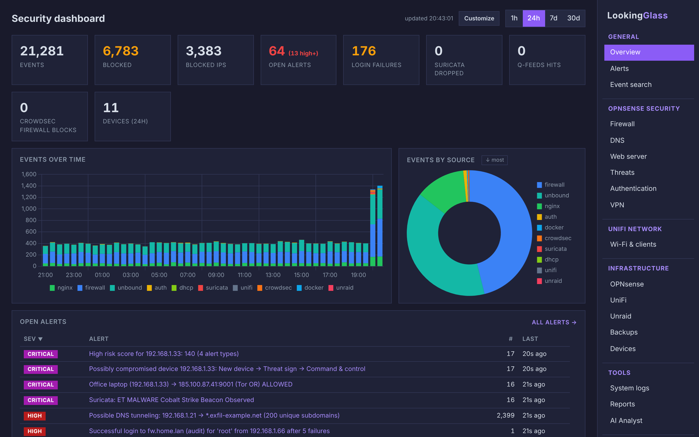

| | |
|---|---|
| **Alerts** - every alert says why it got its severity, which device it is and where it is connected; mute, re-rate or ask the AI | **AI analyst** - asks the database itself and answers with findings and actions |
| 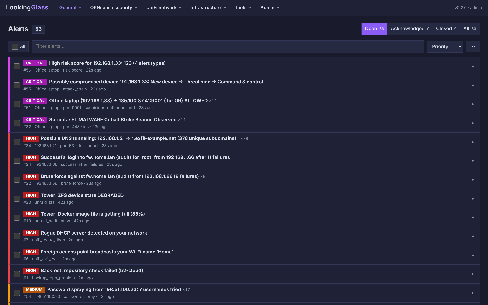 | 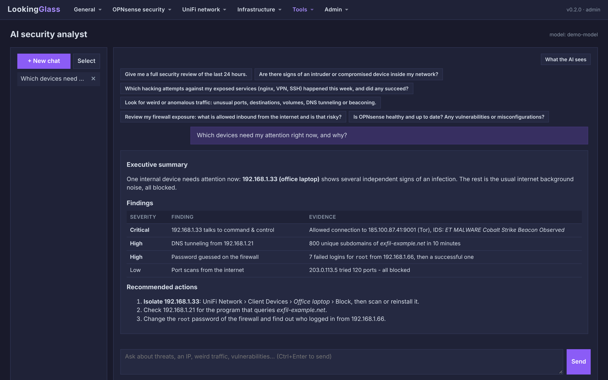 |
| **Firewall dashboard** - one of eight dashboards (DNS, web server, threats, logins, VPN, Wi-Fi, logs) | **Devices** - inventory from ARP, DHCP and UniFi, with risk score and learned behaviour |
| 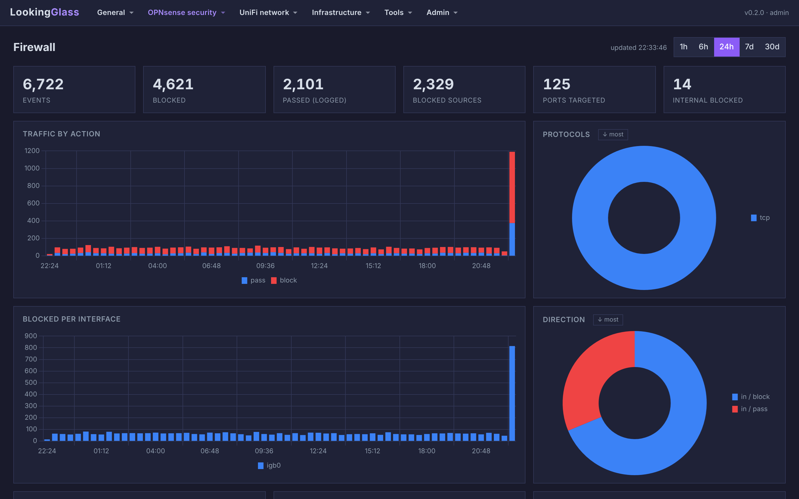 | 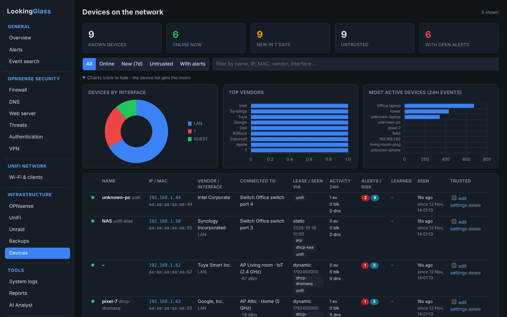 |
| **OPNsense** - hardware, load, temperatures, gateways, interfaces and services | **UniFi** - access points, switches, Wi-Fi and wired clients, neighbouring Wi-Fi |
| 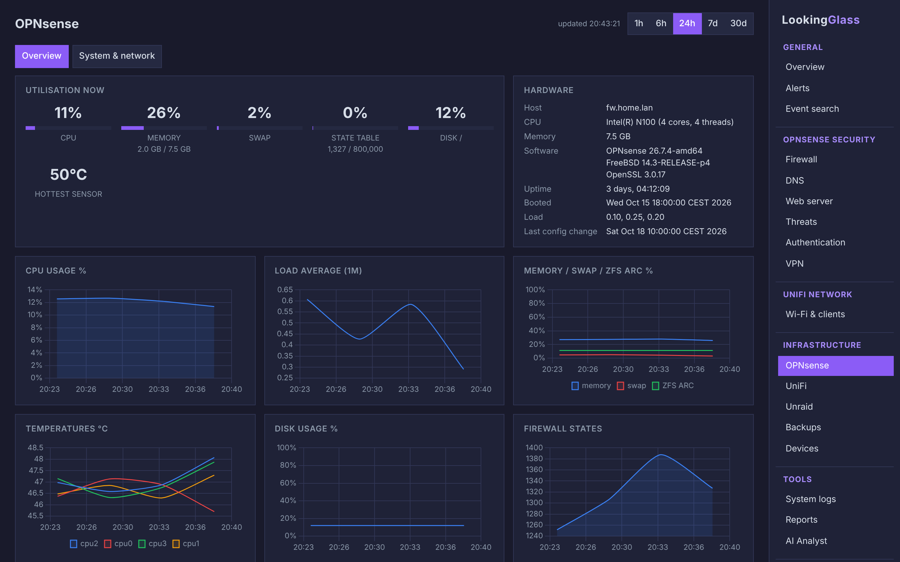 | 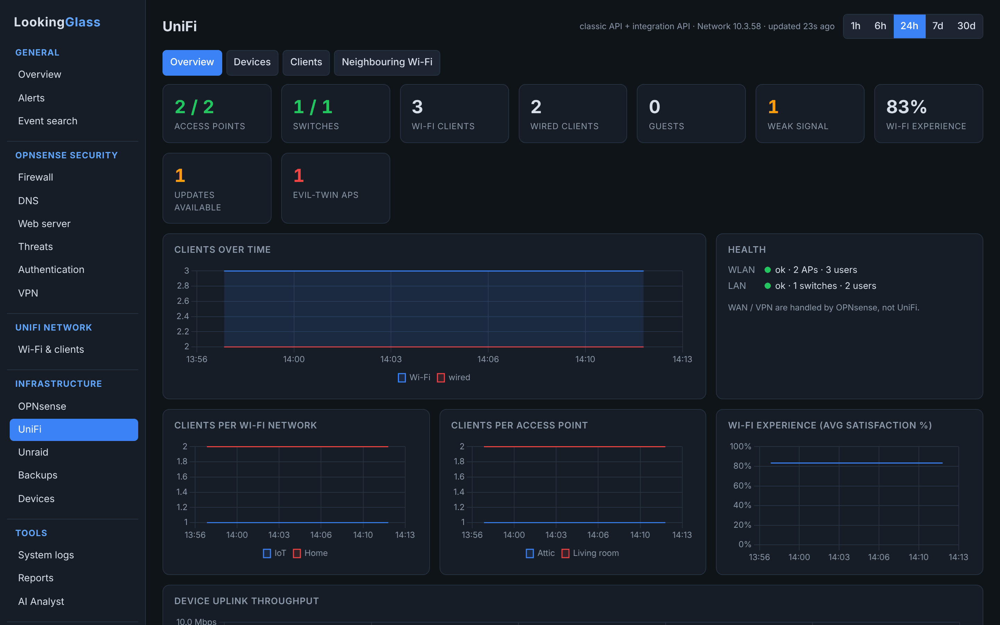 |
| **Unraid** - array, disks (never woken up), Docker, VMs, UPS, packages inside every container | **Reports** - daily / weekly / monthly, all or per part (OPNsense, UniFi, Unraid, Backups), with an AI analysis |
| 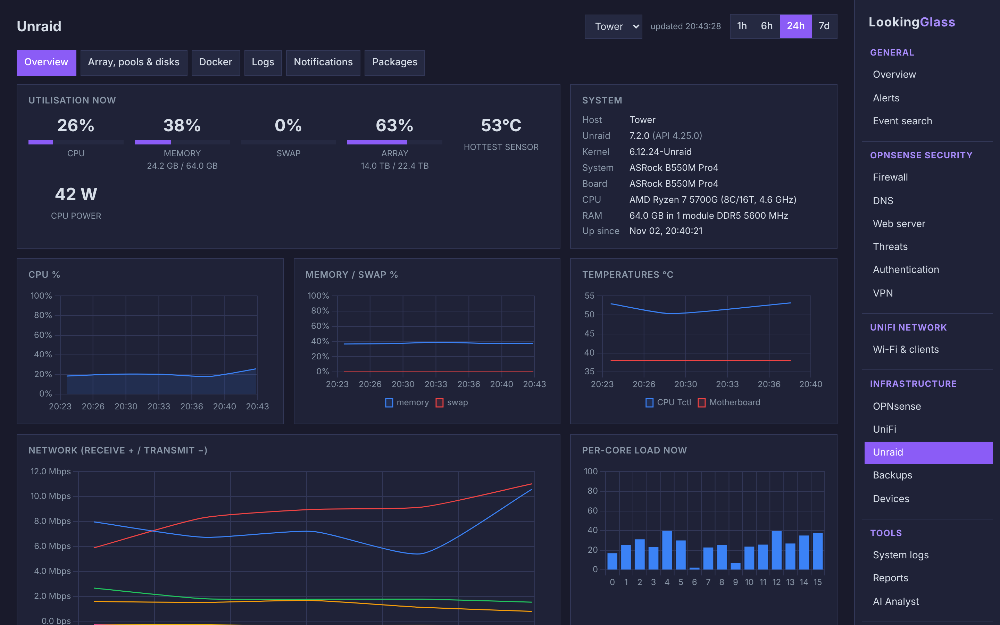 | 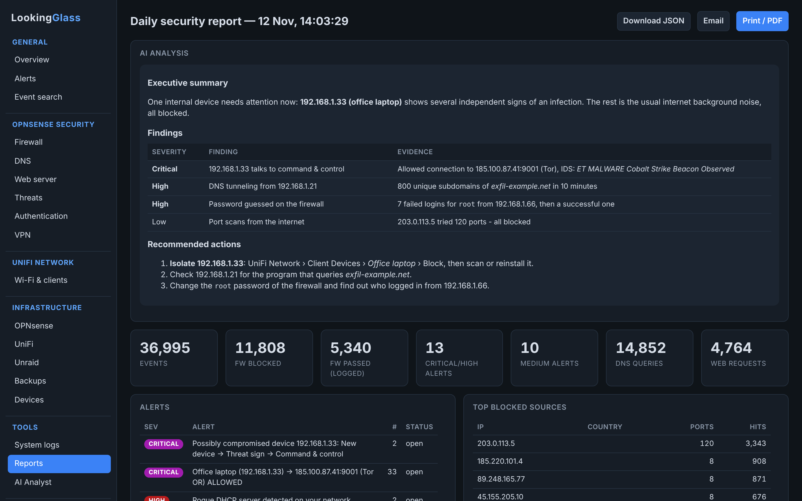 |
| **Setup & status** - checks every data source and says exactly what to change where | **Settings** - everything in the web UI (secrets encrypted), every detection with its own switches and exceptions |
| 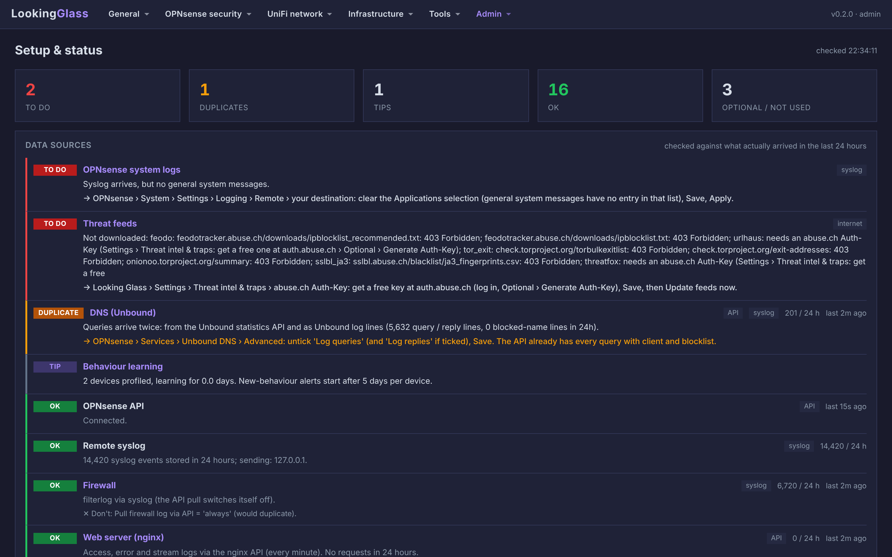 | 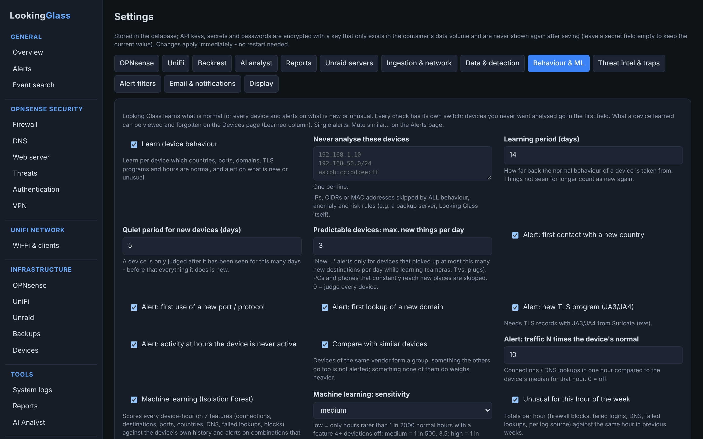 |

## What it collects

| Source | How | What you get |
|---|---|---|
| Firewall (pf `filterlog`) | syslog, or API fallback | blocked/allowed traffic, rule names, scans, sweeps |
| nginx plugin | syslog (access via nginx *SYSLOG Targets*, errors automatically) | requests, status codes, attack patterns (SQLi, RCE, traversal, scanners), WAF / rate limit |
| Unbound DNS | API (reporting DB) and/or syslog (`log-queries`) | per-client queries, blocklist hits, NXDOMAIN, DNS tunneling / DGA detection |
| CrowdSec | API (alerts + decisions) + syslog | scenarios, bans |
| Suricata | API + syslog | signatures, classifications |
| Q-Feeds | API (events + stats) | threat-intel matches, especially **internal hosts contacting malicious IPs** (needs logged block rules, see step 6) |
| SSH / web GUI / OpenVPN / IPsec | syslog | failed and successful logins, config changes |
| DHCP leases (Kea, dnsmasq, ISC) + ARP | API + syslog | **device list**: name, IP, MAC, vendor, interface, lease, online state, per-device activity; **new/rogue device** alerts |
| System / hardware | API | CPU %, load, memory, swap, ZFS ARC, disks, temperatures, states, interface throughput/errors, gateways, services, top processes, firmware updates |
| **UniFi** | UniFi Network API (API key or local account) | access points, switches (ports, PoE, errors), consoles: state, firmware/updates, load; **Wi-Fi / wired clients** with AP or switch port, SSID, signal, experience, traffic; health; client connects / roams, device offline, **rogue / evil-twin APs, rogue DHCP**; and *where* every device is connected, shown in alerts and the device list |
| **Unraid** | Unraid API (GraphQL) + optional Docker socket proxy | CPU/cores, memory, temperatures, network, array/parity, disks (temp, errors, SMART), shares, **Docker containers** (state, CPU/mem) and **their logs**, Unraid syslog, **notifications**, VMs, UPS (Unraid UPS service, or the **NUT plugin** via upsd port 3493), **packages inside every container image** (Syft, optional) |
| **Backrest** (restic backups) | Backrest API (read only, user + password) | plans, repositories, schedules and retention; **every backup run** with result, duration, data scanned / added, files and **speed**; forget / prune / check runs; repository size, compression and snapshot count over time; alerts for failed, overdue and warning backups and failed repository checks |
| **SWAG** (Docker reverse proxy) | its log folder, mounted read-only | every request (site, path, status, attack patterns), nginx errors, **CrowdSec bouncer and AppSec / WAF blocks**, **fail2ban** matches / bans / *banned now* per jail, **honeypot** hits |
| **CrowdSec** (Docker) | Local API (machine login / bouncer key) + metrics | alerts with scenario, AS, country, target site / URI, AppSec rule and decisions; active decisions incl. community blocklist; which logs CrowdSec reads, AppSec counters, live bouncers |
| **Bichon** (mail archive) | Bichon API (read only, an API token - "Metrics only" is enough) | mail accounts with sync interval, **every mail sync** with result (ok / partial / failed), duration, new mails and failed folders; mails archived, archive and search-index size over time; Bichon's own backup; alerts for failed, partial and overdue syncs and a failed Bichon backup |

## What it detects

Port scans, host sweeps, brute force and password spraying, logins after failures or from new countries, web attacks,
Suricata / CrowdSec / Q-Feeds hits, fail2ban bans and honeypot hits (SWAG), DNS tunneling and random (DGA) domains, beaconing, lateral movement, DNS bypass,
attack chains, new and rogue devices, evil-twin access points, rogue DHCP, ARP spoofing, canary traps, resource and
service problems on OPNsense and Unraid, WAN lines that get slower or lose packets over days, failed backups and more. On top of that it learns what is normal for every
device (behaviour & machine learning) and checks traffic against threat-intel feeds. Every alert explains its severity
and can be muted, mailed, closed or **snoozed** for a maintenance window. From an alert you can **block** the attacker
in OPNsense (one alias Looking Glass fills and empties again; optionally automatic for the worst alerts) and open a
**timeline** of everything that address or device did. An **audit log** records every login and change, and a
**backup** of the database plus encryption key is one click (restore with one command).

Details: [Detections and alerts](docs/detections.md) · [Behaviour, machine learning and threat intel](docs/behaviour-and-threat-intel.md)
· [AI analyst](docs/ai-analyst.md)

## Documentation

| Page | What is in it |
|---|---|
| [Installation details](docs/installation.md) | setup wizard, MFA, the Settings tabs (incl. Display), password reset, GeoIP, PostgreSQL notes, backup and restore, updating, database load |
| [OPNsense setup](docs/opnsense.md) | the API user and key, remote syslog, firewall logging, Unbound, nginx, VPN, Suricata, Q-Feeds, CrowdSec |
| [UniFi](docs/unifi.md) | adding a UniFi controller (API key or local account) |
| [Unraid](docs/unraid.md) | adding Unraid servers, alerts, spun-down disks, container packages |
| [SWAG, CrowdSec, fail2ban and honeypot](docs/swag.md) | mounting SWAG's logs, a CrowdSec login, honeypot traps |
| [Backups: Backrest and Bichon](docs/backups.md) | backup jobs and mail-archive syncs |
| [Using Looking Glass](docs/user-guide.md) | a tour of every page: overview, alerts, timeline, dashboards, WAN quality, devices, event search, reports; blocking in OPNsense; snooze / maintenance windows; audit log |
| [Detections and alerts](docs/detections.md) | every detection, alert filters, email notifications, closing alerts, severity |
| [Behaviour, machine learning and threat intel](docs/behaviour-and-threat-intel.md) | learned device behaviour, anomaly detection, threat feeds, traps |
| [AI analyst](docs/ai-analyst.md) | what the AI can do, timeouts, privacy mode (pseudonyms) |
| [Docker: running hardened](docs/docker.md) | non-root, no capabilities, `docker run` example |
| [Security notes](docs/security.md) | logins, secrets, what to expose |
| [Development](docs/development.md) | running from source, mock servers, tests, architecture |

## Installation

You need a machine that runs Docker (Linux server, NAS, VM…) and that the OPNsense box can reach. Looking Glass
brings its own PostgreSQL container; no passwords or API keys go into environment variables - the database
connection and your login are entered in a setup wizard on first start, the integrations later under *Settings*, all
stored encrypted.

**1. OPNsense web UI** – create an API user and key: *System › Access › Users* › **+**, privileges *GUI - All pages*
(or stricter), then **API keys** › **+** downloads `key=` / `secret=`. Details: [OPNsense setup](docs/opnsense.md).

**2. Shell on your Docker host** – get the compose file and create the data folder and database password:

```bash
mkdir -p ~/looking-glass && cd ~/looking-glass
curl -O https://raw.githubusercontent.com/GitTimeraider/Looking-Glass/master/docker-compose.yml
mkdir -p data secrets && sudo chown 10001:10001 data    # the container runs as this uid:gid, never as root
openssl rand -hex 24 > secrets/db_password && chmod 700 secrets && chmod 644 secrets/db_password
```

**3. Optional, same folder** – a `.env` file, only to change `PUID` / `PGID` (user the container runs as; must own
`data`) or `PUBLIC_URL` (HTTPS / reverse proxy, needed for passkeys):
`curl -o .env https://raw.githubusercontent.com/GitTimeraider/Looking-Glass/master/.env.example`, then `nano .env`.

**4. Same folder – start it:**

```bash
docker compose up -d
docker compose logs looking-glass        # shows the one-time setup code
cat secrets/db_password                  # the database password, for the wizard
```

**5. Browser** – open `http://<docker-host>:8080`. The wizard asks for the setup code, the database (keep the
defaults, paste the password) and your account. After logging in you set up MFA (authenticator app or passkey).

**6. Looking Glass web UI › Settings** – enter OPNsense (URL, key, secret), optionally UniFi, Unraid, Backrest,
Bichon and the AI analyst; set *Ingestion & network › Syslog allowed senders* to your OPNsense IP. *Display* sets
theme, accent, menu bar, corners, application name, logo and favicon.

**7. OPNsense web UI** – send its logs to Looking Glass: *System › Settings › Logging › Remote*, destination = Docker
host, port `514`, *rfc5424* ✓. Full list of what to enable: [OPNsense setup](docs/opnsense.md#send-logs-from-opnsense-opnsense-web-ui).
Then check **Setup & status** in Looking Glass - it tells you exactly what is still missing.

Everything about these steps (wizard, MFA, settings, forgotten password, GeoIP, PostgreSQL 18 notes):
[Installation details](docs/installation.md).

### Updating (shell on your Docker host, in `~/looking-glass`)

```bash
docker compose pull && docker compose up -d
```

## Docker

Image: `ghcr.io/gittimeraider/looking-glass:latest` (linux/amd64 + linux/arm64). Ports: `8080` web UI, `5514`
UDP/TCP syslog (mapped to host port `514`). Volume: `/data` (encryption key, saved database connection, optional
GeoIP database) - **back up `./data/lookingglass.key` together with your database**.

Ready-made compose files:

| File | Use it when |
|---|---|
| [`docker-compose.yml`](docker-compose.yml) | standard: Looking Glass + its own PostgreSQL |
| [`examples/docker-compose.https.yml`](examples/docker-compose.https.yml) + [`Caddyfile`](examples/Caddyfile) | you want HTTPS (required for **passkeys**) via a bundled Caddy reverse proxy |
| [`examples/docker-compose.external-postgres.yml`](examples/docker-compose.external-postgres.yml) | you already run PostgreSQL 14+ |
| [`examples/docker-compose.all-in-one.yml`](examples/docker-compose.all-in-one.yml) | Portainer / Dockge stacks: no files next to the stack |
| [`examples/docker-compose.secrets.yml`](examples/docker-compose.secrets.yml) | unattended install without the wizard (database + first login from Docker secret files) |
| [`examples/docker-compose.build.yml`](examples/docker-compose.build.yml) | build the image from source |
| [`examples/docker-compose.unraid-socket-proxy.yml`](examples/docker-compose.unraid-socket-proxy.yml) | run **on Unraid**: a read-only Docker API for per-container CPU/memory on Unraid API older than 4.29, and (with `IMAGES=1`) the exact image of each container for *Unraid › Packages* |
| [`examples/unraid/looking-glass.xml`](examples/unraid/looking-glass.xml) | run Looking Glass itself **on Unraid** as a Docker template |


The image runs as uid/gid **10001** and needs **no Linux capabilities**: `user:`, `cap_drop: [ALL]` and
`no-new-privileges` are already set in every compose file. Other users, `docker run` and Unraid: [Docker: running hardened](docs/docker.md).

## Configuration reference

**In the web UI (Settings, stored in the database, secrets encrypted, applied live):** OPNsense URL / API key /
secret / TLS verification / custom CA / poll interval / per-source pulls · UniFi URL / API key / username / password /
site / TLS verification / poll interval / events · AI base URL / API key / model / limits /
scheduled report (every N days, hour, what it covers, mail recipients) · syslog allowed senders, extra internal
networks, time zone · retention, detection interval, GeoIP path · Unraid servers (URL, API key, Docker API) · container packages (on/off, image source, exclusions, registry
login, Syft options).

**In the setup wizard (first start, stored encrypted in `/data/database.conf`):** database host / port / name /
user / password / SSL mode · first account.

**Environment variables (all optional, need a container restart):**

| Variable | Default | Meaning |
|---|---|---|
| `DATABASE_URL` (or `DATABASE_URL_FILE`) | – (setup wizard) | PostgreSQL connection; when set, the wizard's database step is skipped |
| `DATABASE_PASSWORD_FILE` | – | read the DB password from a Docker secret file and insert it into `DATABASE_URL` |
| `ADMIN_USER` / `ADMIN_PASSWORD` (or `ADMIN_PASSWORD_FILE`) | – (setup wizard) | first account, created only when no user exists; skips the wizard's account step |
| `PUID` / `PGID` | `10001` | compose files: the `user:` the container runs as (must own `./data`). `docker run`: use `--user` instead |
| `DATA_DIR` | `/data` | data volume (encryption key, saved database connection, GeoIP database) |
| `LG_ENCRYPTION_KEY_FILE` | `/data/lookingglass.key` | alternative location of the encryption key (e.g. a Docker secret) |
| `PUBLIC_URL` / `WEBAUTHN_RP_ID` | auto | public https URL / passkey relying-party id when behind a reverse proxy |
| `COOKIE_SECURE` | `false` | mark the session cookie HTTPS-only |
| `SECRET_KEY` (or `SECRET_KEY_FILE`) | generated, stored in DB | cookie signing key |
| `WEB_PORT` / `SYSLOG_UDP_PORT` / `SYSLOG_TCP_PORT` | `8080` / `5514` / `5514` | container listen ports |
| `LOG_LEVEL` | `INFO` | logging verbosity |
| `LOG_AI_REQUESTS` | `false` | `true` logs every request to the AI endpoint and what started it (chat / Ask AI, report, daily report, connection test) |

## Security

Password + mandatory MFA (TOTP or passkey), encrypted credentials that are never shown again, a read-only SQL tool
for the AI and optional pseudonyms for everything sent to the AI provider. Keep port 8080 on your LAN / management
network. More: [Security notes](docs/security.md).
